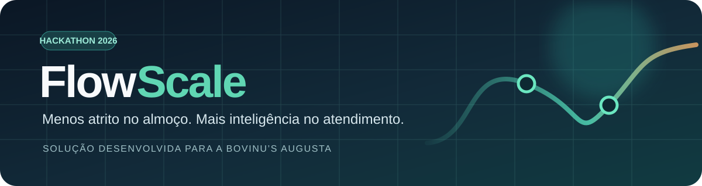
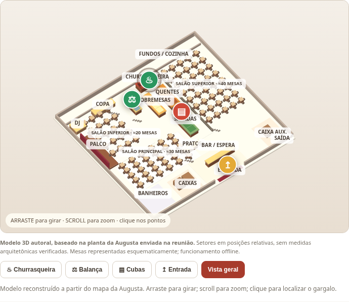
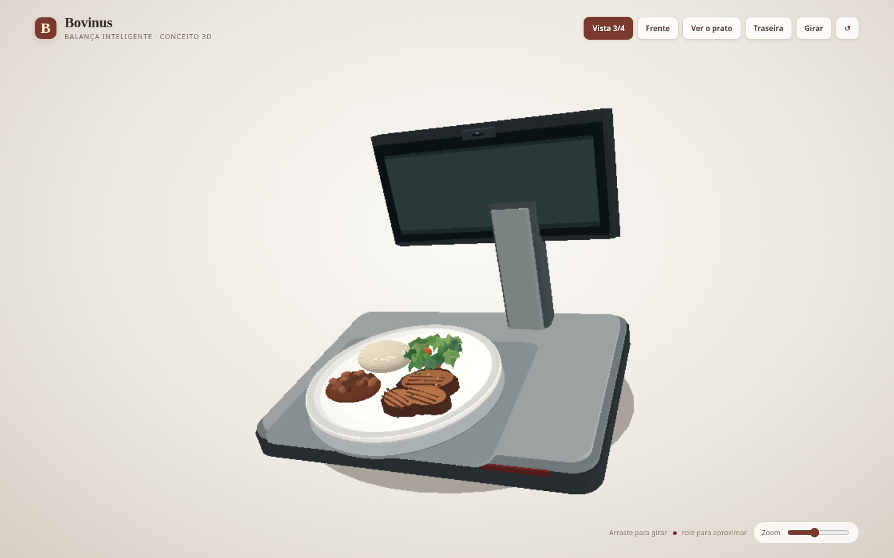
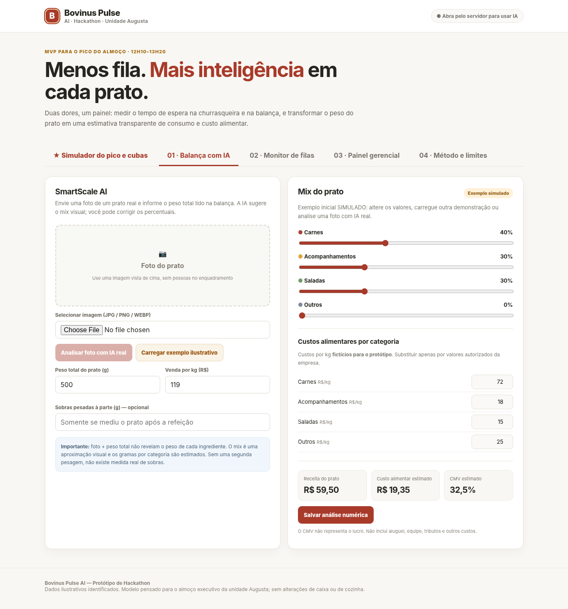
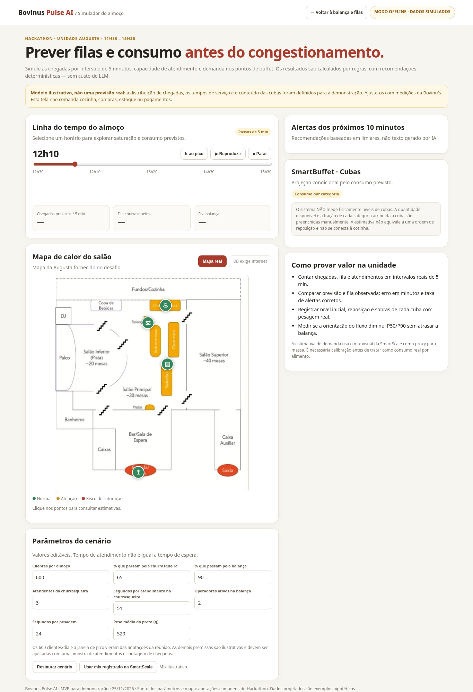
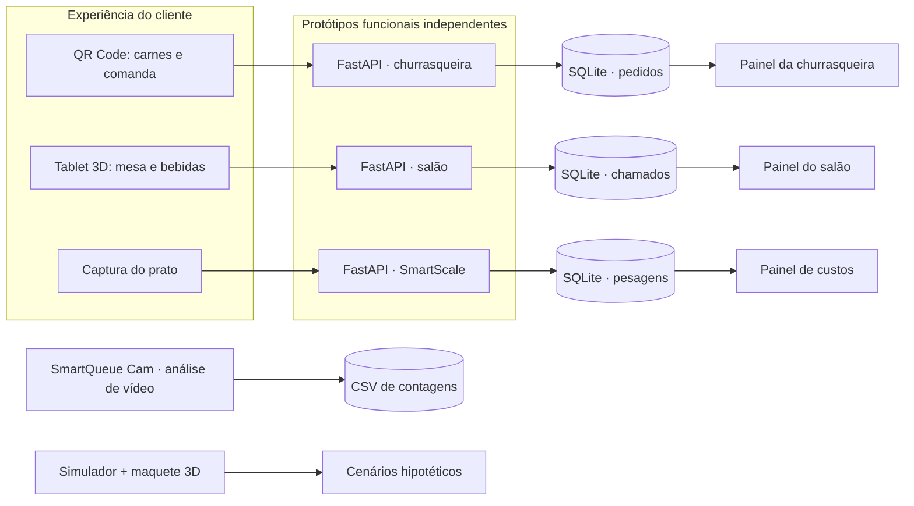
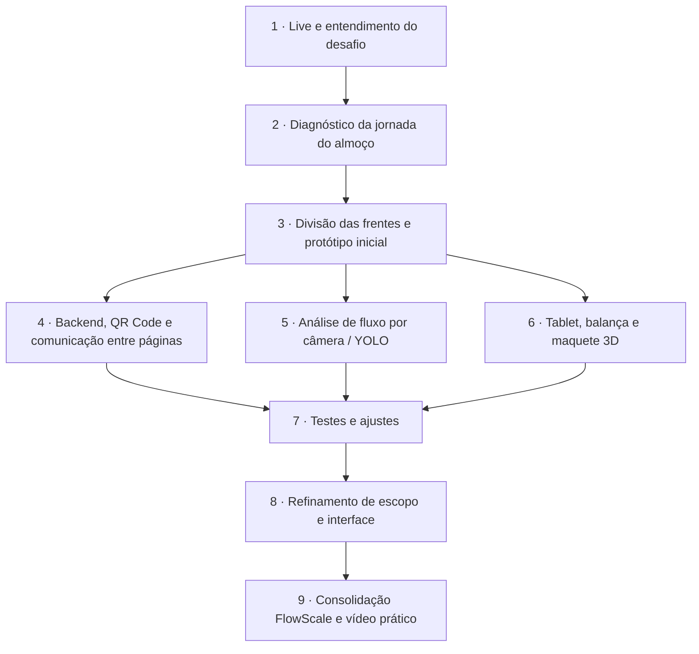

<div align="center">



# FlowScale

### Tecnologia para uma jornada de almoço executivo mais fluida, inteligente e conectada.

**Solução desenvolvida para a Bovinu's Augusta • Hackathon 2026 • São Paulo/SP**

[](#-o-que-foi-entregue)
[](#-contexto-do-desafio)
[](#-por-que-utilizamos-3d)
[](#-tecnologias)


**[Contexto](#-contexto-do-desafio) · [Soluções](#-o-que-foi-entregue) · [Arquitetura](#-arquitetura-e-integração) · [Executar](#-como-rodar-na-sua-máquina) · [3D](#-por-que-utilizamos-3d) · [Equipe](#-equipe-e-responsabilidades)**

</div>

---

## 📌 Sobre o projeto

O **FlowScale** é um conjunto de protótipos desenvolvidos para melhorar a **experiência do almoço executivo na Bovinu's Augusta**. A proposta surgiu do entendimento de que, em um restaurante com fluxo intenso e janela de almoço limitada, **alguns minutos de espera podem afetar toda a jornada do cliente**.

Em vez de criar apenas uma apresentação conceitual, a equipe optou por **construir e testar** interfaces reais: solicitação de carnes via QR Code, comunicação entre cliente e equipe por painel, atendimento nas mesas por tablet 3D, protótipo de balança com análise visual de pratos e uma ferramenta de visão computacional para estudar a concentração de pessoas.

> **Propósito:** transformar dificuldades observadas na rotina do almoço em experiências digitais demonstráveis, sem interferir na cozinha, no estoque ou no pagamento do restaurante.

**Estado atual:** MVP/prova de conceito, com módulos locais executáveis. **Não houve implantação operacional na Bovinu's nem comprovação estatística de redução de filas ou de custos.**

## 🎯 Contexto do desafio

### O que aprendemos na live com a Bovinu's

A empresa compartilhou informações sobre a operação e os horários de maior pressão. Esses dados foram a **base do diagnóstico**, não medições realizadas pelo nosso software.

| Indicador compartilhado | Referência do desafio | Relação com o FlowScale |
|---|---|---|
| 🕦 Janela do almoço | **11h30 às 15h30** | Entender toda a jornada do cliente |
| 🔥 Pico principal | **12h10 às 13h20** | Priorizar a experiência do executivo com tempo limitado |
| 👥 Movimento em dias úteis | **~600 clientes/dia** | Considerar a concentração da demanda |
| 📅 Finais de semana | **~250 clientes/dia**, como referência relatada | Diferenciar o comportamento do almoço executivo |
| 🥗 Variedade de saladas | **~30 opções** | Amplitude do buffet e tempo de escolha |
| 🍲 Pratos quentes | **~30 opções** | Variedade e fluxo de serviço |
| 🥩 Churrasqueira | **~10 opções de carnes/cortes** | Ponto central da organização por QR Code |
| 🍮 Sobremesas | **~20 opções** | Complexidade e variedade da experiência |
| ⚖️ Pesagem | **3 balanças**, às vezes com **1 ou 2 operadores** | Possível gargalo e oportunidade de análise |
| ⏳ Fila observada/relatada | **Cerca de 8 pessoas** em um ponto crítico | Justificativa para investigar o fluxo |
| 🕐 Espera na churrasqueira | **4 min** como referência ruim; **2min30s** como mais aceitável | Hipótese de melhoria a validar |

Outros pontos levantados: o restaurante recebe profissionais de **escritórios, bancos e empresas da região**; o serviço de churrasqueira é um diferencial importante; a janela entre **12h30 e 14h** também merece atenção no fluxo geral, mas **o sistema de pagamento não faz parte da nossa intervenção**.

**Observação sobre os números:** todas as quantidades são aproximações informadas na reunião/live e sujeitas à confirmação pela unidade. A fila habitual de oito pessoas não deve ser confundida com os resultados do vídeo de teste da câmera.

### O problema que escolhemos resolver

```text
Cliente chega com pouco tempo para almoçar
            ↓
Escolhe entre dezenas de opções do buffet
            ↓
Encontra a churrasqueira e pode esperar para escolher o corte
            ↓
Passa pela balança e segue para a mesa
            ↓
Precisa localizar um funcionário para pedidos simples
```

Em um **almoço executivo**, o cliente valoriza a variedade e a qualidade, mas também precisa de **previsibilidade, praticidade e agilidade**. Nosso projeto se concentra justamente nos pontos de contato com o serviço.

### O que está dentro — e fora — do escopo

| ✅ Dentro do escopo | 🚫 Fora do escopo |
|---|---|
| Jornada, filas e pontos de concentração | Alterar o preparo da cozinha |
| Organização de solicitações na churrasqueira | Comprar ingredientes ou gerir estoque |
| Estimativa de composição/custo de pratos | Substituir a balança certificada existente |
| Comunicação cliente ↔ equipe de salão | Integrar ou modificar o caixa/pagamento |
| Modelagem 3D e simulação de cenários | Mudar o formato self-service |

---

## 🚀 O que foi entregue

| Frente | O que construímos | Demonstração concreta | Maturidade |
|---|---|---|---|
| **01 · Churrasqueira / QR Code** | Interface do cliente, comanda, múltiplos cortes/pontos, API e painel da equipe | Enviar pedido e vê-lo aparecer em outro painel | **Fluxo funcional no MVP** |
| **02 · SmartQueue Cam** | Detecção de pessoas por YOLO e contagem em região demarcada | Vídeo com pessoas detectadas e contagem por zona | **Ferramenta de análise independente** |
| **03 · SmartScale / Balança** | Captura por webcam, estimativa visual opcional por IA, custos, CMV e dashboard | Registrar uma pesagem estimada e consultar gastos | **MVP com hipóteses e dados de demonstração** |
| **04 · Tablet 3D** | Equipamento 3D interativo, chamados, bebidas, feedback e painel do salão | Enviar solicitação da mesa e recebê-la no painel | **Fluxo funcional no MVP** |
| **05 · Maquete / Simulador** | Maquete conceitual da Augusta, cenários de fila e consumo de cubas | Alterar parâmetros e visualizar efeitos projetados | **Simulação hipotética** |

### 🥩 01 — Churrasqueira inteligente: QR Code + comanda

**Desafio:** o cliente chega à churrasqueira e precisa decidir seus cortes enquanto outras pessoas aguardam.

**Fluxo desenvolvido:**

1. O cliente abre a página por um **QR Code**.
2. Digita o **número da comanda** (ex.: `1579`).
3. Seleciona **mais de um corte de carne**, definindo quantidades e ponto desejado.
4. Confirma a solicitação.
5. O **painel da churrasqueira** recebe os itens vinculados à mesma comanda.
6. A equipe acompanha e atualiza o **status do atendimento** e pode usar a notinha de identificação.

**O que foi efetivamente integrado:** página do cliente ↔ **FastAPI** ↔ **SQLite** ↔ painel da equipe. O módulo inclui consultas e atualização de status de pedidos.

**Limite importante:** a solicitação **não dispara preparo antecipado**, não reserva automaticamente carnes e não muda a forma como a churrasqueira trabalha. A equipe continua seguindo a disponibilidade do atendimento normal. O potencial de redução de tempo ainda depende de um piloto real.

### 🎥 02 — SmartQueue Cam: câmera para analisar o fluxo

O SmartQueue Cam foi criado por meio de uma abordagem de **visão computacional com YOLO**. O programa analisa um vídeo ou câmera, delimita uma área no chão e conta pessoas dentro daquela região, ajudando a **visualizar onde o fluxo é maior**.

**Nosso objetivo com essa frente foi analítico:** observar concentrações de pessoas e pontos de congestionamento para compreender melhor o desafio. **Não conectamos a câmera ao QR Code, ao tablet ou à maquete**, porque a equipe decidiu manter a demonstração final mais clara e objetiva.

- Calibração de área/polígono na imagem;
- Detecção e contagem de pessoas;
- Visualização local das detecções, quando ativada;
- Exportação de contagens e estimativas para CSV;
- Sem reconhecimento facial e sem gravação de quadros pelo programa documentado.

**Teste de desenvolvimento:** em um vídeo de aproximadamente um minuto, `yolov8s` com análise em `960px` identificou **1 a 4 pessoas** na área. A espera de **30 a 120 segundos** foi uma estimativa calculada com vazão **assumida** de 2 clientes/minuto. **Não são medições da operação da Bovinu's.**

> 📁 O material disponível neste repositório inclui o **resumo técnico da câmera**. Os arquivos executáveis `camera_queue.py` e `requirements_cam.txt` pertencem ao projeto original de análise e **precisam ser adicionados separadamente** para rodar essa frente. Veja [`analise-fluxo/SmartQueue_Cam_Resumo.md`](analise-fluxo/SmartQueue_Cam_Resumo.md).

### ⚖️ 03 — SmartScale: balança inteligente e estudo do CMV

A balança nasceu da pergunta: **o peso total de um prato é suficiente para entender o gasto alimentar?** A resposta é não — é necessário compreender também a **composição**.

Construímos um protótipo que permite:

- Abrir uma **webcam real**, com autorização do navegador, ou enviar uma foto;
- Solicitar uma **análise visual por IA**, se houver credencial de API configurada;
- Revisar as categorias/proporções identificadas;
- **Informar manualmente** o peso total do prato;
- Ajustar custos por categoria e preço de venda por quilo;
- Calcular **receita e CMV estimados**, registrar cenários e exportar informações;
- Consultar um **ranking de grupos de alimentos com maior gasto estimado**.

**Fórmulas do MVP:**

```text
Receita estimada = peso total (kg) × preço por kg
Peso estimado da categoria = peso total × proporção visual da categoria
Custo alimentar estimado = Σ (peso estimado da categoria × custo/kg)
CMV estimado (%) = custo alimentar estimado / receita estimada × 100
```

A live trouxe **R$ 119/kg** como referência para a modalidade por peso. Esse valor pode ser demonstrado como **parâmetro informado no desafio**, não como preço atualizado do restaurante. **Custos por ingrediente usados no MVP são ilustrativos.**

**Muito importante:** a câmera não mede o peso de cada alimento. O protótipo **não está conectado a uma balança física**; a análise visual e a distribuição em gramas precisam de validação com pratos de referência. O CMV é **estimado** e não representa lucro contábil.

### 📱 04 — Tablet 3D: atendimento à mesa

Desenvolvemos um tablet tridimensional **realmente manipulável**, com a interface de atendimento incorporada à **tela do próprio objeto 3D** — não apenas uma imagem ou um painel separado.

O cliente consegue:

- **Chamar o garçom** ou solicitar ajuda;
- Pedir **talheres, guardanapos, limpeza da mesa ou troca de prato**;
- Solicitar **água, refrigerante, suco ou café**;
- Registrar **feedback sobre atendimento, espera e limpeza**.

A solicitação é salva pelo backend e aparece no **painel do salão**, que acompanha o andamento e a conclusão. A demonstração pode ser aberta com a mesa `12`.

**Integração implementada:** tablet da mesa ↔ API ↔ SQLite ↔ painel da equipe. **Não há integração com cobranças, estoque ou pedidos da cozinha.**

### 🗺️ 05 — Maquete 3D e simulador do almoço

Criamos uma **representação conceitual tridimensional** da unidade Augusta, com áreas de circulação, churrasqueira, balanças e buffet para ajudar a entender a relação entre os ambientes.

O simulador possibilita estudar, com premissas editáveis:

- Chegadas em **intervalos de 5 minutos** no almoço;
- Número de operadores e tempo médio de atendimento;
- Fila/espera **projetadas** para churrasqueira e balanças;
- Comportamento **hipotético** das cubas conforme nível inicial e consumo informado;
- Pontos de atenção (*hotspots*) sobre a planta/maquete.

**Os dados do simulador são cenários, não previsões treinadas com histórico real nem sensores instalados.**

---

## 🖼️ Demonstrações visuais

<sub>Capturas de protótipos desenvolvidos durante o hackathon. Algumas telas preservam o nome interno histórico “Bovinus”; **FlowScale** é o nome final do projeto. As imagens representam software demonstrativo, não uma instalação física.</sub>

<table>
  <tr>
    <td width="50%"><br/><b>Maquete conceitual da Augusta</b></td>
    <td width="50%"><br/><b>Modelo 3D da balança e do prato</b></td>
  </tr>
  <tr>
    <td><br/><b>SmartScale — composição e custos estimados</b></td>
    <td><br/><b>Simulação de pico e buffet</b></td>
  </tr>
</table>

## 🧊 Por que utilizamos 3D?

O uso de modelagem tridimensional foi uma **decisão de desenvolvimento para tornar a solução concreta e compreensível**. A equipe não queria apenas descrever telas ou mostrar slides: quis demonstrar **onde os equipamentos estariam, como o cliente interagiria com eles e o que seria possível observar**.

| Recurso 3D | Objetivo de experiência | Resultado desenvolvido |
|---|---|---|
| **Tablet interativo** | Mostrar a ação do cliente na mesa | Dispositivo rotacionável com botões dentro de sua própria tela |
| **Balança inteligente** | Visualizar o equipamento e a posição da câmera | Plataforma, estrutura e sensor representados em 3D |
| **Prato e alimentos** | Dar destaque à experiência de pesagem | Louça com volume, carne grelhada, arroz, feijão e salada modelados |
| **Maquete da unidade** | Comunicar circulação, posições e gargalos | Representação conceitual com perspectiva, zoom e hotspots |

**Tecnologias:** JavaScript, **WebGL**, modelos `.glb` e alternativas visuais compatíveis. A **versão final de apresentação da balança** foi simplificada para focar **somente no objeto 3D e no prato**, enquanto os cálculos e o painel permanecem no módulo funcional separado.

> O 3D é um **protótipo visual interativo**. Não é um projeto de engenharia pronto para fabricação, um equipamento de pesagem certificado ou um sensor efetivamente instalado.

---

## 🏗️ Arquitetura e integração

### Visão por fluxos



**O diagrama mostra três integrações funcionais internas e duas frentes independentes.** Não existe, nesta versão, uma API central ou banco único ligando QR Code, tablet, balança e câmera.

### Integração entre páginas: como comprovamos o fluxo

Um dos pontos mais importantes de desenvolvimento foi garantir que **a ação em uma interface realmente aparecesse em outra**:

- **Comandas:** o cliente envia os itens; o backend registra e o **painel da churrasqueira** consegue buscar, atualizar e exibir o pedido.
- **Salão:** o tablet envia o chamado; a equipe acompanha a mesma solicitação e registra seu status.
- **Balança:** a pesagem demonstrativa salva os dados; o **dashboard** consulta os registros e agrega custos estimados.

Essa comunicação de ponta a ponta foi central nos testes, especialmente nas verificações de **comandas e atualização entre páginas**.

### O que ainda não foi integrado — por escolha de escopo

- SmartQueue Cam não alimenta ao vivo os indicadores da maquete;
- Não há API central unificando as bases de dados;
- Não há leitura automática da comanda oficial ou conexão com pagamento;
- O tablet não está ligado ao sistema comercial de bebidas;
- A balança 3D não transmite peso de um dispositivo físico;
- O projeto não emite ordens automáticas de preparo para a cozinha.

**A integração principal do FlowScale é a da jornada e do objetivo de atendimento, preservando módulos independentes que podem ser avaliados separadamente.**

---

## 🛠️ Tecnologias

<div align="center">

</div>

| Tecnologia / recurso | Como foi utilizado |
|---|---|
| **Python** | Regras de negócio, APIs, testes e análise de vídeo |
| **FastAPI + Uvicorn** | Servidores locais e endpoints dos módulos |
| **HTML5 + CSS3 + JavaScript** | Interfaces de cliente, painéis e experiências interativas |
| **SQLite** | Persistência local de pedidos, chamados e pesagens nos módulos correspondentes |
| **WebGL + geometria 3D + `.glb`** | Equipamentos e maquete tridimensionais |
| **YOLO / Ultralytics** | Detecção de pessoas na ferramenta de análise de filas |
| **OpenCV** | Manipulação de imagens e vídeo no SmartQueue Cam |
| **API de IA visual (opcional)** | Classificação visual aproximada dos alimentos no protótipo da balança |
| **QR Code** | Acesso simplificado à interface da churrasqueira |
| **Git, GitHub e VS Code** | Organização do desenvolvimento e apresentação do código |

---

## 📂 Estrutura do repositório

```text
FlowScale/
├── README.md                       # Você está aqui
├── .gitignore                      # Dados locais e credenciais não versionados
├── assets/                         # Banner e capturas do projeto
├── documentacao/
│   └── FlowScale_Projeto_Completo.md
├── modulos/
│   ├── nucleo-web/                 # MVP, QR Code, churrasqueira e simulador
│   │   ├── app.py
│   │   ├── grill.py
│   │   ├── requirements.txt
│   │   ├── churrasqueira_cliente.html
│   │   ├── churrasqueira_painel.html
│   │   └── simulador.html
│   ├── tablet-3d/                  # Tablet, backend do salão e painel
│   │   ├── app.py
│   │   ├── salao.py
│   │   ├── requirements.txt
│   │   └── tablet_3d_real.js
│   ├── balanca-ia/                 # Webcam, análise, CMV e dashboard
│   │   ├── app.py
│   │   ├── balanca3d.js
│   │   ├── requirements.txt
│   │   └── painel.html
│   └── balanca-prato-3d/           # Modelo visual final e prato 3D
│       ├── index.html
│       ├── modelo3d.js
│       └── Bovinus_Balanca_e_Prato_3D.glb
└── analise-fluxo/
    └── SmartQueue_Cam_Resumo.md    # Registro da análise; código original à parte
```

> **Nota de nomenclatura:** os módulos foram criados em etapas e conservam nomes históricos como `Bovinus` em classes, páginas e arquivos. **Bovinu's é o restaurante**; **FlowScale é o nome da solução.** Não renomeamos automaticamente o código para não comprometer caminhos e funcionalidades já testados.

---

## 💻 Como rodar na sua máquina

### Pré-requisitos

- **Windows 10/11** com **Python 3.10+**, instalado e acessível pelo terminal;
- **VS Code**, com a extensão Python recomendada;
- **Chrome ou Edge** atualizado;
- Internet apenas para instalar pacotes e, se utilizada, acessar a API de análise visual;
- Webcam opcional para a balança; para a câmera de filas, é preciso dispor do **código original e do vídeo/câmera** da análise.

> ✅ Execute os comandos **dentro da pasta do módulo** onde está o `app.py` e o `requirements.txt`. Não execute `uvicorn app:app` na raiz do repositório. Abra **um terminal por módulo** e deixe cada servidor aberto.

### 1. Clonar ou baixar

```powershell
# Caso já exista um repositório remoto configurado:
git clone URL_DO_SEU_REPOSITORIO
cd FlowScale

# Se você baixou o ZIP, basta extrair e abrir a pasta FlowScale no VS Code.
```

**Substitua `URL_DO_SEU_REPOSITORIO` pelo endereço real após publicar no GitHub.** Nenhum endereço de repositório foi presumido neste documento.

### 2. Núcleo web + QR Code da churrasqueira — porta 8000

No terminal do VS Code, a partir da **raiz do repositório**:

```powershell
cd modulos\nucleo-web
python -m pip install -r requirements.txt
python -m uvicorn app:app --port 8000
```

| Página | URL |
|---|---|
| Inicial / SmartScale inicial | http://127.0.0.1:8000/ |
| Cliente — churrasqueira | http://127.0.0.1:8000/churrasqueira |
| Painel — churrasqueira | http://127.0.0.1:8000/churrasqueira/painel |
| Gerador de QR Code | http://127.0.0.1:8000/churrasqueira/qr |
| Simulador do almoço | http://127.0.0.1:8000/simulador |

**Demonstração sugerida:** comanda `1579` → escolher dois cortes → confirmar → abrir painel → conferir pedido e status. **PIN padrão de demonstração:** `2468` (não adequado para uso público).

### 3. Tablet 3D + painel do salão — porta 8001

**Abra um novo terminal** e, a partir da raiz do repositório:

```powershell
cd modulos\tablet-3d
python -m pip install -r requirements.txt
python -m uvicorn app:app --port 8001
```

| Página | URL |
|---|---|
| Tablet 3D da mesa 12 | http://127.0.0.1:8001/tablet-3d?mesa=12 |
| Painel do salão | http://127.0.0.1:8001/salao/painel |
| Maquete | http://127.0.0.1:8001/maquete |

**Teste rápido:** no tablet, solicitar **água** ou **guardanapos** → abrir o painel do salão → verificar o chamado → atualizar o atendimento. **PIN padrão de demonstração:** `2468`.

### 4. Balança inteligente + análise de custos — porta 8002

**Abra outro terminal** e, a partir da raiz do repositório:

```powershell
cd modulos\balanca-ia
python -m pip install -r requirements.txt
python -m uvicorn app:app --port 8002
```

| Página | URL |
|---|---|
| Balança 3D funcional | http://127.0.0.1:8002/balanca-3d |
| Painel de custos | http://127.0.0.1:8002/painel |
| Saúde da API | http://127.0.0.1:8002/api/health |

**Sem API paga:** utilize os cenários demonstrativos identificados como **demo**, informe o peso manualmente, salve uma pesagem e observe o painel.

**Para habilitar a análise visual por IA**, no PowerShell, **antes de iniciar o servidor**:

```powershell
$env:OPENAI_API_KEY="SUA_CHAVE_DE_API"
# Opcional: $env:OPENAI_MODEL="gpt-4.1-mini"
python -m uvicorn app:app --port 8002
```

> 🔐 Nunca publique a chave no GitHub, no frontend ou em capturas de tela. O acesso à API possui cobrança e credenciais próprias. **A webcam real é do dispositivo; o modelo 3D representa a posição do sensor e não substitui a câmera física.**

### 5. Modelo final: só a balança e o prato 3D

Abra diretamente este arquivo no Chrome/Edge:

```text
modulos/balanca-prato-3d/index.html
```

**Não precisa instalar pacotes, usar Python ou ligar um servidor.** Arraste para girar, use o zoom e escolha a vista superior para observar o prato. Essa versão é **exclusivamente visual** e não calcula CMV.

### 6. SmartQueue Cam — análise independente

O diretório `analise-fluxo` contém a documentação e o procedimento do experimento, **não a cópia dos scripts executáveis originais**. Para executar a ferramenta, coloque nessa pasta os arquivos originais `camera_queue.py` e `requirements_cam.txt` e instale as dependências documentadas:

```powershell
cd analise-fluxo
python -m pip install -r requirements_cam.txt

# Exemplo: calibrar a zona de análise com um vídeo autorizado
python camera_queue.py --source fila.mp4 --calibrar fila

# Exemplo: executar a contagem
python camera_queue.py --source fila.mp4 --mostrar --vazao-padrao 2 --modelo yolov8s.pt --imgsz 960 --conf 0.25 --fps 3
```

O resultado do código original é registrado em `fila_camera.csv`. **Não é necessário executar a câmera para demonstrar o QR Code, o tablet ou a balança.**

### 7. Testes automatizados

Instale bibliotecas usadas nos testes, se ainda não estiverem disponíveis:

```powershell
python -m pip install httpx pytest
```

Nos respectivos diretórios, execute:

```powershell
# modulos\nucleo-web
python teste_churrasqueira.py
python teste_selecao_multipla.py

# modulos\tablet-3d
python teste_tablet_independente.py

# modulos\balanca-ia
python -m pytest teste_balanca.py -q
```

Os testes verificam fluxos e regras do MVP, **não substituem** um piloto no restaurante, testes de ergonomia, segurança ou aferição da precisão da IA.

### Problemas comuns

| Situação | Como resolver |
|---|---|
| `Could not import module "app"` | Abra o terminal na pasta do **módulo correto**, não na raiz |
| `requirements.txt` não encontrado | Use `dir` para conferir a pasta e depois `cd` até onde está o arquivo |
| A URL não abre | Confirme se o servidor continua ligado e se a porta indicada está livre |
| A webcam não abre | Autorize a câmera no navegador e teste em `localhost`; feche outros apps usando a webcam |
| Tela 3D não aparece | Atualize Chrome/Edge; teste outra máquina ou renderização compatível |
| IA visual não analisa foto | Confira `OPENAI_API_KEY` e as permissões da API; use demo se não houver chave |
| Painel não recebe o pedido | Confirme que o **mesmo servidor** atende página do cliente e painel; observe o terminal |
| PIN não funciona | Utilize o PIN de demonstração ou configure as variáveis de ambiente correspondentes |

---

## 🧪 Metodologia: da live ao protótipo

O projeto não surgiu pronto. A equipe realizou **iterações sucessivas**, discutindo fluxos, criando telas, observando falhas e alterando decisões de implementação.



### Evolução durante o hackathon

| Marco | Aprendizado / mudança |
|---|---|
| **Diagnóstico e MVP inicial** | Relacionar tempo de espera, prato, consumo e atendimento à experiência do almoço |
| **Simulador e maquete** | Representar o pico e a circulação por cenários compreensíveis |
| **Churrasqueira v0.4 → v0.5** | Adequar o fluxo às restrições: **não solicitar preparo automático** |
| **Churrasqueira v0.6** | Permitir múltiplos cortes na mesma comanda; validar persistência e status |
| **Tablet independente** | Construir o objeto 3D com interação **dentro da tela**; corrigir erro de renderização |
| **Balança 3D** | Iterar câmera, proporções, prato e acabamento; separar visual 3D da análise funcional |
| **SmartQueue Cam** | Testar parâmetros YOLO para melhorar a detecção em vídeo de câmera alta |
| **Demonstração final** | Trocar slides genéricos por prova de funcionamento de ações reais nos sistemas |

### Engajamento, colaboração e persistência

Nossa equipe trabalhou de forma **participativa e iterativa**, unindo desenvolvimento de backend e experiências 3D, investigação por câmera e verificação da comunicação entre páginas. O foco foi **resolver problemas vistos na jornada do almoço** e transformar uma proposta em algo que os avaliadores pudessem **abrir, clicar, testar e observar**.

A evolução dos modelos 3D ilustra essa postura: revisamos o posicionamento da câmera, melhoramos as proporções do equipamento, corrigimos falhas de interface e reconstruímos o prato para que a demonstração fosse mais intuitiva. Da mesma forma, refinamos o fluxo da churrasqueira para respeitar a rotina real do restaurante.

---

## 👥 Equipe e responsabilidades

| Integrante | Registro acadêmico (RA) | Contribuições no projeto |
|---|---|---|
| **Ana Paula Lopes Travassos** | **2026108913** | **Desenvolvimento backend** das soluções, estrutura dos serviços e APIs, além de **desenvolvimento e refinamento dos modelos e interações 3D** |
| **Luiz Gustavo da Silveira** | **2026103979** | **Análise das câmeras**, investigação de fluxo de pessoas com visão computacional/YOLO e contribuição na **apresentação da solução** |
| **Marcelo Martins Araujo Junior** | **2026108269** | Desenvolvimento e validação do **fluxo de comandas**, com atenção à **comunicação entre páginas e sistemas**, conferindo se as solicitações feitas em uma tela apareciam corretamente na outra |

**Trabalho coletivo:** entendimento da live, debates sobre o escopo, testes, melhoria dos fluxos e preparação da demonstração para os avaliadores. As responsabilidades acima refletem a divisão relatada pela equipe, sem excluir a colaboração entre integrantes.

---

## 🏆 Como demonstramos a solução para a próxima fase

O vídeo de **2 minutos** foi estruturado para mostrar **os protótipos funcionando**, e não apenas apresentar slides ou falar sobre ideias.

| Tempo | Frente | Evidência mostrada |
|---|---|---|
| **00:00–00:12** | Introdução | Nome FlowScale e objetivo prático do projeto |
| **00:12–00:47** | QR Code da churrasqueira | Comanda, seleção de carnes, confirmação e pedido aparecendo no painel |
| **00:47–01:07** | Análise por câmera | Detecção de pessoas para identificar áreas de maior fluxo — **somente análise** |
| **01:07–01:32** | Balança inteligente | Equipamento/prato em 3D e conceito de composição e custo |
| **01:32–01:54** | Tablet 3D | Solicitação realizada na mesa e recebida pelo painel do salão |
| **01:54–02:00** | Encerramento | Síntese das entregas e convite à validação na unidade |

**Mensagem aos avaliadores:** construímos protótipos que permitem demonstrar a comunicação cliente–equipe, o estudo do movimento de pessoas e a modelagem 3D de soluções adequadas à jornada do almoço executivo.

---

## 📊 Impacto esperado e critérios para validar

| Hipótese | O que queremos melhorar | Como medir em uma segunda fase |
|---|---|---|
| Organização da churrasqueira | Tempo gasto na escolha e atendimento | Tempo de fila, mediana, P90 e volume de pedidos concluídos |
| Compreensão de gargalos | Identificar concentração por faixa horária | Contagem e tempo de espera em amostras reais autorizadas |
| Visibilidade dos custos | Entender categorias com maiores gastos | Composição de pratos conhecidos, desvio da IA e comparação com custos autorizados |
| Experiência nas mesas | Facilitar pedidos e chamados | Tempo até o atendimento e conclusão, avaliação de clientes |
| Comunicação digital | Reduzir perda de informações entre interfaces | Taxa de pedidos enviados, recebidos e concluídos |

**Ainda não afirmamos redução de X minutos ou economia de Y%.** Esses resultados dependem de teste controlado no restaurante, antes e depois, com dados reais e condições comparáveis.

### Segurança e privacidade

- O **SmartQueue Cam** tem finalidade de **contagem**, não reconhecimento facial. Não publicar vídeos de pessoas reais sem autorização.
- As fotos da balança devem evitar rostos, documentos e dados pessoais; o uso de APIs externas exige cuidados adicionais.
- O **PIN `2468` é apenas para demonstração local**. Em produção, é necessário controle de acesso e gestão segura de credenciais.
- Não versionar arquivos `.db`, `.sqlite3`, fotos privadas, vídeos de pessoas ou chaves de API.
- Antes de qualquer piloto, revisar **LGPD, consentimento/base legal aplicável, retenção de dados e operação assistida**.

---

## 🧭 Próximos passos

- [ ] Conduzir piloto autorizado da churrasqueira em horários comparáveis do pico;
- [ ] Medir filas e tempos reais, sem confundir estimativa com observação;
- [ ] Validar a usabilidade do QR Code e tablet com clientes/equipe;
- [ ] Calibrar análise de pratos com pesos por ingrediente conhecidos e custos autorizados;
- [ ] Avaliar câmera física e viabilidade de integração a equipamento de pesagem;
- [ ] Reforçar autenticação, persistência, segurança e adequação à LGPD;
- [ ] Considerar integrações centralizadas **somente se agregarem valor**, evitando tornar o almoço mais complexo.

---

## 🌐 Como publicar no GitHub

O ZIP disponibilizado com esta documentação já contém o `README.md`, as capturas e os módulos **na estrutura indicada acima**. Para publicar em um **repositório novo**:

1. Crie um repositório vazio no GitHub, por exemplo `flowscale-hackathon`.
2. Abra a pasta `FlowScale_GitHub` no VS Code.
3. Execute no terminal dessa pasta:

```powershell
git init
git add .
git commit -m "docs: documenta FlowScale e protótipos do hackathon"
git branch -M main
git remote add origin https://github.com/SEU_USUARIO/flowscale-hackathon.git
git push -u origin main
```

Substitua `SEU_USUARIO` pelo seu usuário real. **Se você já possui um repositório Git configurado**, não rode novamente `git init` ou `git remote add origin`; apenas incorpore os arquivos e faça o commit.

> **Antes de tornar o repositório público:** revise se a planta de referência e as capturas podem ser compartilhadas segundo as orientações da organização, e confirme que nenhum arquivo de clientes, vídeo com pessoas ou segredo foi adicionado.

---

## 💚 Nossa visão

> **FlowScale não é apenas tecnologia pela tecnologia.** É a tentativa de tornar o horário do almoço mais tranquilo para quem tem pouco tempo, preservar o que faz a Bovinu's ser reconhecida — a variedade e a churrasqueira — e apoiar a equipe com informação e solicitações mais organizadas.

Criamos, testamos, corrigimos e evoluímos os protótipos com um objetivo: **mostrar uma solução prática, responsável e possível de ser validada na próxima fase do Hackathon.**

<div align="center">

**FlowScale • Hackathon 2026 • Bovinu's Augusta**

*Desenvolvido por Ana Paula Lopes Travassos, Luiz Gustavo da Silveira e Marcelo Martins Araujo Junior.*

</div>

