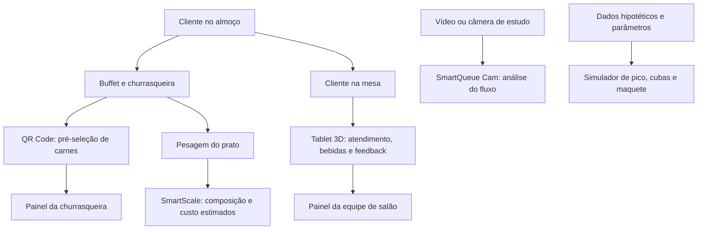
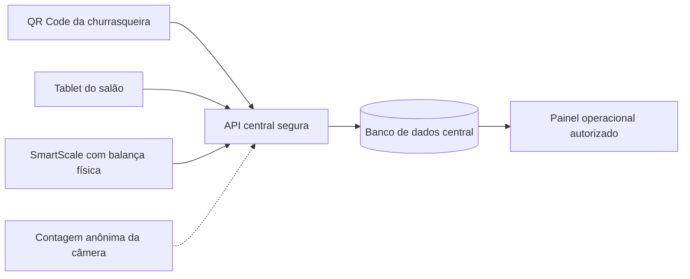

# FlowScale — Documentação completa do projeto

**Hackathon 2026 | Solução desenvolvida para a Bovinu's Augusta, São Paulo**  
**Data de consolidação:** 25 de novembro de 2026  
**Tipo de entrega:** documentação do processo de desenvolvimento, arquitetura, protótipos, integração entre frentes e apresentação final  
**Estágio:** prova de conceito / MVP demonstrativo, ainda não implantado na operação do restaurante

> **Definição do projeto:** FlowScale é o nome da solução completa desenvolvida pelo grupo. **Bovinu's** é o restaurante para o qual a solução foi concebida. Os arquivos de código construídos durante o Hackathon podem conservar o nome histórico “Bovinus”, sem alterar o nome final da proposta.

---

## 1. Resumo executivo

O **FlowScale** é uma solução tecnológica concebida para apoiar a melhoria da jornada do cliente no almoço da **Bovinu's Augusta**, com foco em quatro necessidades: **organização do atendimento na churrasqueira, análise do fluxo de pessoas, visibilidade sobre a composição e o custo dos pratos e agilidade na comunicação entre mesas e equipe de salão**.

O trabalho partiu do estudo do desafio do restaurante, das observações apresentadas pela empresa, de referências do espaço físico e da análise do funcionamento da jornada do cliente. Em seguida, nosso grupo criou protótipos demonstráveis, com interfaces, regras de negócio, painéis de equipe, experiências em 3D e mecanismos de análise de dados.

### Principais entregas

| Frente | Entrega desenvolvida | Papel na solução |
|---|---|---|
| **Churrasqueira por QR Code** | Interface do cliente, seleção de múltiplos cortes, identificação por comanda, painel da churrasqueira e acompanhamento de status | Organizar as solicitações e reduzir etapas de escolha no atendimento presencial |
| **Smart Cam** | Detecção e contagem de pessoas com YOLO em vídeo/câmera e estimativa de espera | **Análise do problema:** identificar locais de maior concentração e compreender os fluxos; não foi integrado aos demais módulos |
| **SmartScale / Balança inteligente** | Protótipo de análise visual de alimentos, estimativa de composição, cálculos de custo/CMV, painel e modelos tridimensionais da balança e do prato | Explorar a geração de informações de consumo e o impacto dos alimentos no custo |
| **Tablet 3D** | Tablet tridimensional interativo, pedidos de atendimento e bebidas, feedback e painel de equipe | Facilitar as solicitações dos clientes nas mesas |
| **Simulador e maquete da Augusta** | Projeções hipotéticas de fila e consumo, alertas de cubas, hotspots e representação 3D conceitual | Apoiar estudos de cenários e a demonstração visual do funcionamento da casa |

**Resultado efetivo do Hackathon:** um conjunto de **protótipos locais executáveis e demonstráveis**, com funcionalidades testáveis. **Não** significa implantação no restaurante nem comprovação de redução de filas, economia financeira ou precisão definitiva da IA.

---

## 2. Contexto, desafio e diagnóstico inicial

### 2.1 Cenário observado

A unidade Augusta recebe um volume concentrado de clientes no horário de almoço, especialmente profissionais que precisam fazer a refeição em pouco tempo. Nas informações repassadas durante o desafio, foram mencionados:

- Cerca de **600 clientes por dia útil** como referência relatada pela empresa.
- Serviço de almoço aproximadamente entre **11h30 e 15h30**.
- Pico de maior movimento próximo de **12h10 a 13h20**.
- Fila habitual de aproximadamente **8 pessoas** em um dos pontos críticos, conforme observação informada pelo grupo.
- Na churrasqueira, **4 minutos** foram citados como uma espera indesejável, enquanto **2 minutos e 30 segundos** foram usados como referência mais favorável.
- Existência de **três balanças**, sem garantia de três operadores atendendo simultaneamente em todos os momentos.
- Ampla variedade de saladas, pratos quentes e carnes, com diferenças importantes de custo entre os itens servidos.

Esses números são **referências do levantamento inicial**, não indicadores medidos ou auditados pelo FlowScale durante uma implantação.

### 2.2 Jornada do cliente analisada

O grupo estudou o caminho habitual do cliente no restaurante:

**Entrada → escolha dos alimentos no buffet → atendimento na churrasqueira, quando desejado → pesagem do prato → escolha de mesa → consumo e atendimento no salão → saída.**

Os principais pontos de interesse foram:

1. **Churrasqueira:** concentração de pessoas e tempo dedicado à escolha dos cortes.
2. **Balança:** passagem obrigatória de clientes que utilizam o serviço por peso e oportunidade de compreender o mix do prato.
3. **Circulação:** identificação de áreas onde o fluxo se concentra.
4. **Mesas:** solicitações simples de bebidas, talheres, guardanapos, limpeza e assistência à equipe.

### 2.3 Objetivo geral

**Demonstrar como recursos digitais, visão computacional e modelos tridimensionais podem organizar o atendimento, apoiar a análise do movimento e fornecer informações úteis para a experiência do cliente e para a gestão da unidade.**

### 2.4 Limites do escopo

O projeto foi delimitado para **não alterar** a operação da cozinha, as receitas, as compras, o estoque, os sistemas de caixa/pagamento nem o formato self-service. A proposta atua sobre a **jornada de atendimento, medição, comunicação e análise de dados**.

A pré-seleção de carnes, por exemplo, **não é uma ordem automática de preparo**; a equipe continua definindo e confirmando o que está disponível no atendimento normal.

---

## 3. Metodologia e etapas do desenvolvimento

O desenvolvimento ocorreu de forma incremental: **levantamento → formulação de hipóteses → prototipação → implementação → testes → revisão da experiência → documentação e demonstração**.

### Etapa 1 — Entendimento do desafio

- Leitura do material apresentado pela Bovinu's e das referências da unidade Augusta.
- Identificação das restrições: trabalhar na experiência de serviço, sem mexer na operação de cozinha e caixa.
- Levantamento de pontos de fila, circulação, pesagem e atendimento nas mesas.
- Registro dos horários críticos e das referências de demanda e de tempo de espera.
- Definição da hipótese central: parte do atrito do almoço pode ser compreendida e potencialmente reduzida com melhor informação e comunicação.

**Produto dessa etapa:** diagnóstico preliminar e definição das frentes de trabalho.

### Etapa 2 — Primeiro MVP: fila, prato e painel gerencial

Foi criada uma aplicação web inicial para demonstrar:

- **SmartScale:** análise visual opcional de foto do prato, classificação aproximada por categorias de alimento e estimativa de custos.
- **SmartCam:** registro manual de duração de filas e atendimento, com indicadores estatísticos.
- **Painel gerencial:** apresentação de informações e exportação de dados para análise.

As rotinas de exemplo permitiram demonstrar conceitos mesmo sem dados históricos ou dispositivos instalados na unidade. Dados inseridos por simulação receberam identificação própria.

**Aprendizado:** fotografia e peso total podem apoiar uma estimativa do mix, mas **a câmera não mede sozinha a massa exata de cada ingrediente**.

### Etapa 3 — Simulação do pico e representação espacial

O trabalho foi expandido com:

- **SmartQueue Predict:** modelo hipotético de chegadas e capacidade em intervalos de cinco minutos, ajustável por número de atendentes e tempo de serviço.
- **SmartBuffet:** estimativa condicional de consumo de categorias e risco de redução do nível de cubas, usando valores iniciais e participações informadas manualmente.
- **Maquete 3D da Augusta:** reconstrução conceitual do espaço a partir da planta apresentada, com áreas como churrasqueira, balanças, buffet e salões.
- **Hotspots:** visualização ilustrativa de áreas mais críticas durante o pico.
- **Modo offline:** página de demonstração para os cálculos de cenário sem depender da internet.

**Aprendizado:** simulações são úteis para discutir hipóteses, mas não substituem medições reais, nem devem ser apresentadas como previsão treinada com dados históricos.

### Etapa 4 — Desenvolvimento do QR Code da churrasqueira

Foram produzidas páginas de cliente, painel da equipe e um cartaz com QR Code. A evolução do módulo passou por três marcos:

- **v0.4:** fluxo inicial de solicitação, consulta de status e painel.
- **v0.5:** revisão de escopo para **não acionar preparo, reservar cortes ou alterar a rotina da cozinha**.
- **v0.6:** possibilidade de selecionar **vários tipos de carne no mesmo pedido**, com quantidades e pontos separados, vinculados a **uma única comanda**.

A versão v0.6 passou a registrar os itens em estrutura própria de banco de dados, com migração prevista para registros do formato anterior.

**Aprendizado:** o QR Code deve funcionar como ferramenta de **organização do atendimento**, não como promessa automática de que a carne ficará pronta antes ou de que a fila diminuirá.

### Etapa 5 — Tablet de atendimento nas mesas

Uma implementação inicial de tablet foi apresentada em conjunto com a maquete (v0.7), e depois foi criado um **projeto independente em 3D**. O dispositivo foi construído como um objeto tridimensional manipulável, com **a interface dentro da tela do próprio tablet**.

Foram implementados:

- Atendimento: garçom, talheres, guardanapos, limpeza, troca de prato e ajuda.
- Bebidas: água, refrigerante, suco e café, com seleção de quantidade.
- Feedback: atendimento, espera e limpeza.
- Painel do salão: recebimento, acompanhamento e conclusão dos chamados.

Durante os testes, foi corrigido um erro de JavaScript que interrompia a renderização da tela 3D. Também foi mantido um modo visual alternativo para navegadores sem WebGL.

### Etapa 6 — Balança Inteligente 3D e refinamento visual

A balança foi desenvolvida em duas linhas complementares:

1. **Módulo funcional de análise:** interface de captura por webcam, upload de foto, envio opcional para API de visão computacional, revisão de proporções, entrada manual de peso, custos editáveis, persistência local e painel gerencial.
2. **Modelo físico 3D para demonstração:** equipamento tridimensional com plataforma, visor, câmera conceitual e prato modelado.

A aparência do equipamento passou por diversas revisões em resposta aos testes visuais: reposicionamento da câmera, simplificação do corpo da balança, criação de coluna traseira com sensor integrado e, por fim, **destaque total ao objeto 3D e ao prato**, sem painéis externos ao modelo.

O modelo visual final inclui **louça com volume, carne grelhada, arroz, feijão, folhas, tomate e pepino**, com comandos para girar, aproximar e observar o prato por cima. Esse **visualizador final é independente e não realiza pesagem nem análise de IA**; tais funções permanecem no protótipo funcional separado.

### Etapa 7 — SmartQueue Cam: investigação por câmera

Foi desenvolvido, separadamente, um programa Python que usa **YOLO** para detectar e contar pessoas em uma zona demarcada em vídeo ou câmera, com cálculo de espera estimada a partir de uma vazão informada ou observada.

**Decisão final do grupo:** usar essa frente **somente para análise de onde o fluxo é maior e onde podem surgir concentrações de pessoas**, sem integrá-la à interface final do FlowScale. Isso mantém a solução e o vídeo de apresentação mais objetivos.

### Etapa 8 — Consolidação e preparação para a segunda fase

- Organização dos protótipos executáveis e de seus comandos de inicialização.
- Construção do nome final **FlowScale** para a solução completa.
- Definição de uma demonstração de **dois minutos**, focada em ações realizadas nos sistemas e não em slides conceituais.
- Separação, na comunicação, entre funcionalidades demonstráveis, dados simulados e melhorias futuras.

---

## 4. Estrutura funcional da solução

### 4.1 Visão geral



**Como ler o desenho:** as setas representam o **fluxo de utilização e as conexões internas a cada módulo**. Elas **não** significam que todas as aplicações já compartilham uma base de dados ou uma API única. O SmartQueue Cam é uma ferramenta de análise **independente**, e o simulador trabalha com cenários e parâmetros, não com a câmera alimentando a maquete ao vivo.

### 4.2 Camadas da arquitetura

| Camada | Tecnologias/elementos utilizados | Função |
|---|---|---|
| Experiência do cliente | HTML, CSS, JavaScript, interface QR, tablet 3D | Solicitar carnes, atendimento e bebidas |
| Modelagem e interação tridimensional | JavaScript, WebGL, canvas, arquivos `.glb` e alternativa visual compatível | Demonstrar equipamentos e layout em 3D |
| Servidor e APIs locais | Python, **FastAPI**, servidor **Uvicorn** | Receber e consultar solicitações, disponibilizar páginas e processar regras |
| Registro de informações | **SQLite** em módulos específicos; armazenamento local do navegador em partes do MVP | Guardar pedidos, chamados, avaliações e pesagens demonstrativas |
| Visão computacional | **YOLO / Ultralytics**, vídeo, câmera e delimitação de zonas | Contar pessoas para análise do fluxo |
| Análise visual de prato | Webcam/upload e integração opcional com API de IA, mediante credencial | Sugerir categorias e proporções de alimentos |
| Análise operacional | Indicadores, cálculos de fila, composição de prato, CMV e simulações | Apoiar diagnóstico e estudo de cenários |

### 4.3 Organização dos ambientes de demonstração

As versões consolidadas foram preparadas como projetos locais independentes para evitar conflitos entre demonstrações:

| Ambiente | Porta local habitual | Endereços principais |
|---|---:|---|
| **FlowScale — núcleo web** (arquivos historicamente chamados `Bovinus`) | `8000` | `/`, `/simulador`, `/churrasqueira`, `/churrasqueira/painel`, `/churrasqueira/qr` |
| **Tablet 3D independente** | `8001` | `/tablet-3d?mesa=12`, `/salao/painel`, `/maquete` |
| **Balança 3D funcional + análise** | `8002` | `/balanca-3d`, `/painel`, `/api/health` |
| **Modelo final da balança e do prato** | Sem servidor | `index.html` local e modelo `.glb` |
| **SmartQueue Cam** | Sem porta web obrigatória | Execução de `camera_queue.py` via Python; saída CSV |

O uso de portas separadas facilita abrir várias janelas ao mesmo tempo. **Cada servidor deve continuar em execução no terminal enquanto o módulo estiver sendo demonstrado.**

---

## 5. Funcionamento detalhado dos módulos

### 5.1 Churrasqueira inteligente por QR Code

**Problema abordado:** o cliente precisa escolher ou informar os cortes em um ponto que já pode ter fila.

**Fluxo implementado:**

1. O cliente lê o QR Code com o celular ou abre a interface diretamente.
2. Informa o **número da comanda** que já utiliza no restaurante; por exemplo, `1579`.
3. Escolhe até **cinco tipos de corte** por solicitação no protótipo, define quantidades e preferências de ponto, dentro dos limites de demonstração.
4. Confirma os itens da comanda.
5. O pedido é persistido no banco local e aparece no **painel da churrasqueira** com número, cortes e quantidades.
6. A equipe verifica a disponibilidade **conforme o serviço normal**, registra o andamento e, quando aplicável, a entrega.
7. O sistema permite uma **notinha de identificação** impressa pela janela padrão do navegador.

**Integração existente:** cliente QR Code ↔ API do módulo ↔ banco SQLite ↔ painel da churrasqueira. As telas consultam as mesmas informações e acompanham alterações de status.

**Cuidados:** o QR Code **não** faz pagamentos, não lê automaticamente o cadastro da comanda no caixa, não envia ordens de preparo, não controla estoque e não garante separação antecipada de porções. As opções de cortes e os limites do formulário são demonstrativos; qualquer uso operacional depende de autorização e ajustes da unidade.

**Principais arquivos do núcleo:** `grill.py`, `churrasqueira_cliente.html`, `churrasqueira_painel.html`, `churrasqueira_qr.html`, `app.py`, `requirements.txt` e testes de pedidos.

### 5.2 SmartQueue Cam — estudo de concentração de pessoas

**Problema abordado:** entender em quais pontos a fila cresce e onde o movimento se concentra.

**Procedimento implementado:**

1. Selecionar um vídeo ou uma câmera como fonte.
2. Marcar no chão da imagem uma zona poligonal que representa a área de interesse.
3. Executar a detecção de pessoas com YOLO.
4. Contar as detecções cuja posição dos pés esteja dentro da região.
5. Mostrar contagem e caixas de detecção na visualização local, se habilitada.
6. Registrar contagens e estimativas em `fila_camera.csv`, com atualização documentada a cada cinco segundos.

**Fórmula da estimativa de espera:**

```text
espera_estimada_segundos = pessoas_na_zona / vazao_clientes_por_minuto * 60
```

**Teste documentado:** em um vídeo de cerca de um minuto, com câmera alta e pessoas pequenas, o modelo `yolov8n` não identificou corretamente a fila com os parâmetros iniciais. Após testar `yolov8s` com resolução de análise `960`, confiança `0,25` e `3 fps`, o sistema registrou entre **1 e 4 pessoas** na zona, com espera **estimada de 30 a 120 segundos** usando uma vazão **assumida** de dois clientes por minuto.

Esses números **não são medições da fila habitual de oito pessoas na Bovinu's**; são resultados de um vídeo de teste. O método pode subcontar pessoas ocultas ou muito próximas, e a vazão precisa ser calibrada na operação para sustentar estimativas confiáveis.

**Integração existente:** vídeo/câmera → detecção → contagem → CSV. **Não integrado** ao QR Code, à balança, ao tablet ou à maquete nesta entrega.

**Privacidade:** o programa descrito salva dados numéricos, não grava quadros de imagem nem usa reconhecimento facial. Não publicar vídeos de pessoas reais sem a devida autorização.

### 5.3 SmartScale — análise visual, composição e custos

**Problema abordado:** o peso total do prato não revela quanto de cada categoria alimentar foi servido e qual seu possível impacto no custo.

**Fluxo demonstrável no módulo funcional:**

1. Abrir a página da balança inteligente.
2. **Ligar a webcam real do dispositivo** com autorização do navegador ou escolher uma fotografia existente.
3. Fotografar o prato com o enquadramento adequado.
4. Quando configurada uma chave de API válida, enviar a imagem ao serviço de análise visual; sem chave, usar cenários **explicitamente demonstrativos**.
5. Revisar ou corrigir as proporções de categorias sugeridas.
6. Informar **manualmente o peso total**, pois ainda não há balança física integrada ao servidor.
7. Ajustar, quando necessário, preço por quilo e custos de cada categoria.
8. Calcular receita e CMV **estimados**, registrar a simulação e consultar o painel de gastos.

**Equações utilizadas na proposta:**

```text
receita_do_prato = peso_total_kg × preco_venda_por_kg
peso_estimado_categoria_g = peso_total_g × fracao_visual_da_categoria
custo_alimentar_estimado = Σ (peso_categoria_kg × custo_estimado_categoria_por_kg)
CMV_estimado_percentual = custo_alimentar_estimado / receita_do_prato × 100
```

Uma categoria ampla — por exemplo, “carnes” — pode reunir itens com custos diferentes. Logo, o cálculo é uma **aproximação**, não uma apuração contábil por cliente. Os custos inseridos no protótipo são ilustrativos até que a empresa forneça valores reais autorizados.

**Integração existente:** captura/upload → API de análise, quando configurada → revisão do resultado → cálculo e registro local → painel gerencial/CSV. **Não existe integração com sensor físico certificado nem com o caixa da Bovinu's.**

#### Balança física em 3D

Como demonstração do possível equipamento, foi criada uma balança com câmera posicionada de modo conceitual para observar o prato. A evolução visual priorizou:

- Plataforma e prato claramente apoiados.
- Louça com geometria tridimensional e borda curva.
- Alimentos com volume, textura e distribuição visual.
- Câmera discreta integrada à estrutura, evitando aparência de peça solta.
- Rotação, zoom, vista superior e outras perspectivas.

**Importante:** o visualizador 3D final, aberto por `index.html`, **mostra apenas o objeto e o prato**. Ele não executa reconhecimento por IA nem mede peso. As demonstrações de câmera, custo e painel pertencem à **aplicação funcional separada**, na porta `8002`.

### 5.4 Tablet 3D e painel da equipe

**Problema abordado:** solicitações simples feitas nas mesas podem depender de localizar um funcionário disponível.

**Fluxo implementado:**

1. O cliente abre o tablet de uma mesa, como a mesa `12`.
2. Interage com as opções **diretamente na tela do objeto 3D**, girando ou aproximando o dispositivo se desejar.
3. Escolhe uma solicitação de atendimento ou uma bebida e confirma.
4. O servidor registra o chamado e o envia ao painel da equipe de salão.
5. O funcionário consulta o chamado, registra o início e a conclusão.
6. O cliente também pode registrar feedback de atendimento, espera e limpeza.

**Integração existente:** tablet da mesa ↔ API FastAPI ↔ banco SQLite local ↔ painel de salão. Os chamados e feedbacks pertencem ao módulo do salão, **sem integração com pagamentos, cozinha ou estoque**.

**Detalhe técnico:** o tablet utiliza geometria 3D própria, com tela dinâmica e mapeamento de cliques sobre o objeto; quando WebGL não está disponível, existe um modo compatível. O equipamento e seus botões foram modelados para funcionar como uma **experiência de produto**, não como imagem estática.

### 5.5 Simulador operacional e maquete conceitual

A aplicação principal também desenvolveu recursos de apoio ao estudo do espaço e dos cenários de atendimento:

- Simulação ilustrativa de chegadas por faixas de **cinco minutos**.
- Ajuste de atendentes e tempo de atendimento para estimar capacidade e fila.
- Alertas hipotéticos de cubas com base em nível inicial e consumo projetado.
- Visualização da planta da Augusta e modelo 3D conceitual com hotspots.
- Exportação da maquete em formato `.glb` e página alternativa offline.

Exemplo simplificado das fórmulas empregadas:

```text
capacidade_5min = 300 × operadores_ativos / segundos_por_atendimento
fila_proxima = max(0, fila_anterior + chegadas - capacidade_5min)
espera_projetada_min ≈ 5 × fila_proxima / capacidade_5min
```

**Limitação:** não se trata de um gêmeo digital medido, previsão por aprendizado de máquina nem leitura real de nível de cubas. As dimensões da maquete e as curvas de demanda são **aproximadas e/ou hipotéticas**.

---

## 6. Integração entre as diferentes frentes

### 6.1 Integração operacional: uma jornada, várias soluções

As frentes foram desenhadas para apoiar etapas complementares do serviço:

| Momento da jornada | Frente relacionada | Contribuição potencial |
|---|---|---|
| Antes ou durante a passagem pela churrasqueira | QR Code | Antecipar a escolha e melhorar a organização das solicitações |
| Ao longo da circulação e das filas | SmartQueue Cam | Mapear concentração de pessoas para embasar decisões de melhoria |
| Durante a pesagem | SmartScale | Relacionar o peso informado à composição visual estimada e aos custos |
| Durante a permanência na mesa | Tablet 3D | Registrar pedidos de atendimento e encaminhá-los à equipe |
| No estudo do pico de almoço | Simulador/maquete | Comparar cenários e visualizar gargalos hipotéticos |

Essa é uma **integração de propósito e de jornada**, não necessariamente uma integração técnica entre bancos de dados.

### 6.2 Integrações de software já implementadas

- **Churrasqueira:** interface do cliente e painel da equipe se comunicam com a **mesma API e com o mesmo banco de pedidos**.
- **Salão:** tablet e painel dos funcionários compartilham a **API e os dados de chamados/avaliações**.
- **Balança funcional:** cálculo e armazenamento de pesagens alimentam o **painel de gastos do próprio módulo**.
- **Simulador do núcleo:** permite trabalhar com parâmetros e, em uma das versões, aproveitar no mesmo navegador informações de mix da SmartScale por armazenamento local.
- **SmartQueue Cam:** produz resultados independentes em CSV; não existe conexão automática com os demais módulos.

### 6.3 O que **não** está integrado nesta entrega

- Uma base central única reunindo QR Code, tablet, balança e visão computacional.
- Leitura automática da comanda oficial do restaurante.
- Câmera de contagem de pessoas enviando números em tempo real à maquete.
- Captura automática de peso por dispositivo físico.
- Solicitações do tablet integradas ao sistema comercial de bebidas.
- Envio de ordens à cozinha, alteração de estoque, cobrança ou pagamento.

Essas integrações dependem de infraestrutura, autorização, segurança, dados reais e validação operacional. **Não fazem parte do resultado já entregue.**

### 6.4 Arquitetura possível para uma segunda fase (proposta, não implementada)



A linha pontilhada da câmera representa uma **possibilidade futura**, não uma integração aprovada ou necessária para o MVP. A prioridade sugerida é validar separadamente o benefício de cada frente antes de criar dependências entre elas.

---

## 7. Estrutura de arquivos e execução dos protótipos

Os pacotes foram desenvolvidos e distribuídos separadamente. A árvore a seguir é um **mapa dos entregáveis**, não uma pasta única que já reúna todos os arquivos automaticamente:

```text
FlowScale — entregáveis do Hackathon
│
├── Núcleo web (Bovinus_v06_Multiplas_Carnes.zip)
│   └── Bovinus/
│       ├── app.py                       # servidor FastAPI
│       ├── grill.py                     # regras/API da churrasqueira
│       ├── churrasqueira_cliente.html
│       ├── churrasqueira_painel.html
│       ├── churrasqueira_qr.html
│       ├── index.html                   # SmartScale + filas + painel inicial
│       ├── simulador.html               # previsões condicionais e cubas
│       ├── augusta_3d.js
│       ├── layout_augusta_conceitual.json
│       ├── modelo_augusta_conceitual.glb
│       ├── teste_churrasqueira.py
│       ├── teste_selecao_multipla.py
│       ├── teste_simulador.js
│       └── requirements.txt
│
├── Tablet 3D independente (Bovinus_Tablet_3D_Corrigido.zip)
│   └── Bovinus_Tablet_3D_Interativo/
│       ├── app.py / salao.py
│       ├── tablet_3d.html / tablet_3d_real.js
│       ├── salao_painel.html
│       ├── maquete.html
│       ├── teste_tablet_independente.py
│       └── requirements.txt
│
├── Balança funcional (Bovinus_Balanca_Inteligente_3D.zip
│   ou versão visual redesenhada equivalente)
│   ├── app.py / balanca3d.js
│   ├── balanca.html / painel.html
│   ├── teste_balanca.py
│   └── requirements.txt
│
├── Visualizador final só 3D (Bovinus_Balanca_e_Prato_3D.zip)
│   └── Bovinus_Balanca_e_Prato_3D/
│       ├── index.html / modelo3d.js
│       ├── Bovinus_Balanca_e_Prato_3D.glb
│       └── README.md
│
└── SmartQueue Cam (arquivos documentados no resumo)
    ├── camera_queue.py
    ├── requirements_cam.txt
    ├── zones.json                         # após calibração
    └── fila_camera.csv                    # após execução
```

**Nota de versões:** também foi criada uma versão `Bovinus_v07_Tablets_Mesas.zip` com tablet de mesa integrado ao núcleo e maquete. Para a demonstração com tablet tridimensional totalmente manipulável, o grupo optou pelo **pacote independente corrigido**, mais focado na interação com o equipamento.

### 7.1 Iniciar o núcleo web — porta 8000

No VS Code, abrir a pasta **interna `Bovinus`** (onde ficam `app.py` e `requirements.txt`):

```powershell
python -m pip install -r requirements.txt
python -m uvicorn app:app --port 8000
```

Páginas: `http://127.0.0.1:8000/`, `/simulador`, `/churrasqueira`, `/churrasqueira/painel` e `/churrasqueira/qr`.

### 7.2 Iniciar o tablet 3D — porta 8001

Abrir a pasta interna **`Bovinus_Tablet_3D_Interativo`**:

```powershell
python -m pip install -r requirements.txt
python -m uvicorn app:app --port 8001
```

Abrir `http://127.0.0.1:8001/tablet-3d?mesa=12` e `http://127.0.0.1:8001/salao/painel`.

### 7.3 Iniciar a balança funcional — porta 8002

Abrir a pasta extraída que contém diretamente `app.py` e `requirements.txt`:

```powershell
python -m pip install -r requirements.txt
python -m uvicorn app:app --port 8002
```

Abrir `http://127.0.0.1:8002/balanca-3d` e `http://127.0.0.1:8002/painel`.

A análise real de foto é **opcional** e depende de `OPENAI_API_KEY` configurada no ambiente do servidor. Sem credencial, utilizar os cenários de demonstração devidamente identificados.

### 7.4 Abrir o modelo final da balança e do prato

Extraia `Bovinus_Balanca_e_Prato_3D.zip` e abra `index.html` diretamente no Chrome ou Edge. Não é preciso iniciar Python. A experiência prioriza o equipamento e a comida em 3D.

### 7.5 Executar o SmartQueue Cam

É necessário ter os arquivos de implementação do módulo de câmera, instalar `requirements_cam.txt`, calibrar a região e executar o script sobre um vídeo autorizado. Exemplo documentado:

```powershell
python camera_queue.py --source fila.mp4 --calibrar fila
python camera_queue.py --source fila.mp4 --mostrar --vazao-padrao 2 --modelo yolov8s.pt --imgsz 960 --conf 0.25 --fps 3
```

Esse módulo **não depende** dos servidores nas portas 8000–8002.

### 7.6 Recomendações para rodar no Windows

- Executar cada comando **separadamente** no terminal do VS Code.
- Conferir se o terminal está na pasta que contém **`app.py`** e **`requirements.txt`**. Abrir a pasta externa do ZIP é uma causa comum de erro “arquivo não encontrado”.
- Manter o terminal aberto enquanto cada servidor estiver em uso.
- Caso o navegador mostre uma versão antiga, usar `Ctrl + Shift + R`.
- Se uma porta já estiver ocupada, encerrar a instância antiga com `Ctrl + C` antes de iniciar novamente.
- Os PINs locais `2468` dos painéis da churrasqueira e do salão são **somente de demonstração**. Não devem ser tratados como proteção adequada para publicação na internet.

---

## 8. Testes, evidências e aprendizados

| Frente | Testes ou verificações documentados | Limite da comprovação |
|---|---|---|
| Churrasqueira | Testes da API, seleção de múltiplas carnes, validação e migração de registros de pedidos antigos | Não comprova ganho de tempo em operação real |
| Tablet 3D | Testes de chamados, bebidas, feedback, alteração de status e autorização do painel; correção de erro de renderização | A aparência WebGL deve ser conferida no computador da apresentação |
| Balança funcional | Testes automatizados de API, gravação de pesagens, cálculo de custos e exportação; checagem visual do modo 3D compatível | Câmera física e IA com credencial real precisam de validação no dispositivo usado |
| Modelo 3D final | Verificações visuais de rotação, vista superior, prato e equipamento | Modelo conceitual; não é balança física ou leitor de IA |
| SmartQueue Cam | Comparação de duas configurações YOLO em vídeo de teste e produção de contagens/estimativas | Vídeo curto, vazão assumida; não mediu a fila real da Bovinu's |
| Simulador | Testes de fórmulas, capacidade, chegadas e alertas condicionais | Dados hipotéticos, não previsões calibradas com histórico real |

### Resultados que **não** devem ser anunciados como comprovados

- “Reduzimos a fila de oito para quatro pessoas.”
- “O QR Code economizou X minutos no restaurante.”
- “A IA identifica exatamente o peso de cada alimento.”
- “A balança já está conectada ao sensor físico.”
- “A câmera monitora a maquete ao vivo.”
- “O sistema já calcula o lucro real de cada cliente.”

O valor demonstrado nesta etapa é a **capacidade de executar fluxos digitais e de gerar estimativas organizadas**, criando uma base para futuras validações.

---

## 9. Segurança, privacidade e responsabilidade no uso de dados

1. **Câmera de filas:** a implementação documentada salva contagens e parâmetros, não imagens nem identificação facial. O vídeo de teste com pessoas reais deve ser mantido em ambiente autorizado.
2. **Fotos de pratos:** evitar enquadrar rostos, documentos e comandas identificáveis. No módulo de análise, a fotografia só é enviada à API externa após a ação específica do operador.
3. **Credenciais:** nunca incluir chaves de API no HTML, no vídeo ou no GitHub. Guardá-las em variáveis de ambiente no servidor.
4. **Bancos de dados locais:** SQLite é adequado ao MVP. Para publicação real, é necessário definir persistência, controle de acesso, cópias de segurança e políticas de retenção.
5. **Painéis administrativos:** substituir o PIN simples por autenticação apropriada antes de qualquer uso público.
6. **LGPD:** revisar base legal, sinalização, finalidade do tratamento e minimização de dados antes de testar com clientes reais.
7. **Limitação operacional:** nenhum módulo deve criar novas filas ou tarefas obrigatórias sem comparação de impacto na rotina existente.

---

## 10. Próximos passos para uma segunda fase

Essas atividades são **propostas de validação e evolução**, e não entregas já concluídas:

| Prioridade | Próximo passo | Evidência esperada |
|---|---|---|
| 1 | Testar QR Code em ambiente autorizado, sem modificar a cozinha | Mediana, P90 e pessoas na fila antes/depois, em períodos comparáveis |
| 2 | Observar as filas com método padronizado | Contagens e tempos reais por intervalo de pico |
| 3 | Calibrar balança e análise visual com pratos de composição conhecida | Erro médio da composição estimada e impacto no tempo de pesagem |
| 4 | Substituir custos ilustrativos por tabela autorizada | CMV alimentar estimado com premissas rastreáveis |
| 5 | Avaliar aceitação do tablet nas mesas | Tempo de atendimento e conclusão de solicitações |
| 6 | Revisar segurança, LGPD, interface e suporte | Condições mínimas para piloto controlado |
| 7 | Considerar integração central se houver benefício demonstrado | Requisitos aprovados e indicadores comuns entre módulos |

### Indicadores recomendados

- **Fila da churrasqueira:** tamanho médio no pico, tempo de espera presencial, mediana e P90.
- **Atendimento QR:** volume de solicitações, pedidos concluídos, tempo de atendimento e correções necessárias.
- **Balança:** tempo adicional de captura, percentual de categorias reconhecidas corretamente, desvio da estimativa de custos.
- **Salão:** tempo entre solicitação e início de atendimento; solicitações concluídas; feedback de espera/limpeza.
- **Privacidade e operação:** eventos de falha, reclamações, interrupções e verificações de consentimento.

A melhoria só poderá ser afirmada com **método de medição, amostra, período, premissas e resultados comparáveis**.

---

## 11. Apresentação final da solução — vídeo prático de 2 minutos

**Objetivo do vídeo:** demonstrar o que foi construído para a seleção da segunda fase, com gravações reais das telas e interações. Não é uma apresentação de slides nem um relatório de impacto já comprovado.

### Roteiro de gravação e narração

#### 00:00–00:12 | Abertura

**Imagem:** nome FlowScale, tela inicial do projeto e breve transição para o sistema.

**Narração:**

> “Este é o FlowScale, nosso projeto desenvolvido para a Bovinu's Augusta. Criamos protótipos tecnológicos para melhorar o atendimento, analisar o fluxo de pessoas e compreender os custos alimentares.”

#### 00:12–00:47 | QR Code da churrasqueira

**Imagem:** ler o QR, preencher a comanda `1579`, escolher mais de um corte, confirmar e mostrar o pedido no painel da equipe.

**Narração:**

> “Começando pela churrasqueira, desenvolvemos um sistema de solicitações por QR Code. O cliente informa o número da comanda, escolhe os cortes de carne e seleciona o ponto desejado. Ao confirmar, a solicitação aparece automaticamente no painel da churrasqueira, identificada pela comanda. A equipe consegue visualizar, acompanhar e concluir o atendimento, sem modificar o processo de preparo das carnes.”

#### 00:47–01:07 | Câmera utilizada para análise do fluxo

**Imagem:** vídeo do SmartQueue Cam com detecção de pessoas e contagem na área marcada.

**Narração:**

> “Também utilizamos inteligência artificial e visão computacional para analisar o fluxo de pessoas. Desenvolvemos um sistema que detecta e conta pessoas por câmera, com o objetivo de identificar os locais de maior concentração e compreender onde surgem os principais pontos de congestionamento.”

**Observação:** mostrar apenas a **análise independente**; não afirmar que a câmera está conectada à maquete ou ao atendimento ao vivo.

#### 01:07–01:32 | Balança inteligente 3D

**Imagem:** girar o modelo, mostrar a plataforma, o prato, os alimentos e a posição conceitual da câmera; se desejado, fazer um corte rápido para o cálculo ilustrativo do módulo funcional.

**Narração:**

> “Para analisar o consumo, criamos um protótipo de balança inteligente em 3D, com câmera direcionada para o prato. Demonstramos como a análise visual dos alimentos, combinada ao peso, pode ajudar a estimar a composição do prato e identificar os ingredientes que mais impactam o custo alimentar.”

#### 01:32–01:54 | Tablet 3D

**Imagem:** girar o tablet, fazer uma solicitação de bebida ou atendimento e mostrar a chegada no painel do salão.

**Narração:**

> “Para o atendimento nas mesas, desenvolvemos um tablet 3D interativo. O cliente pode pedir bebidas, solicitar um garçom, pedir talheres, guardanapos ou limpeza e avaliar o serviço. As solicitações são enviadas ao painel da equipe, que acompanha e finaliza cada atendimento.”

#### 01:54–02:00 | Encerramento

**Imagem:** montagem curta dos protótipos e nome FlowScale.

**Narração:**

> “Esse é o FlowScale: tecnologia aplicada à experiência do cliente, com protótipos desenvolvidos e prontos para validação na Bovinu's.”

**Orientação de edição:** utilizar capturas dos protótipos de verdade, mostrando cliques, registros e mudanças de estado. Cortar tempos de carregamento, manter títulos mínimos e verificar o tempo final da voz gravada; os blocos de tempo são um guia de montagem.

---

## 12. Diferenciais e conclusão

O **FlowScale** se diferencia por reunir frentes complementares a partir de um diagnóstico de jornada, em vez de depender apenas de uma ideia abstrata:

- **Entrega prática:** QR Code com painel, tablet 3D com solicitações, demonstração de balança e análise de imagens, além de estudo por câmera.
- **Visão integrada do problema:** filas, consumo, circulação e atendimento nas mesas são observados como partes de uma mesma experiência do almoço.
- **Respeito às restrições:** não mexe em pagamentos, estoque, compras ou produção da cozinha.
- **Evolução iterativa:** os módulos foram desenvolvidos em versões, testados e ajustados, principalmente em seus fluxos e representações 3D.
- **Transparência:** distingue análise real de vídeo, dados de teste, simulação, conceito físico e funcionalidades prontas para apresentação.

### Síntese final

> **FlowScale transforma problemas observados na jornada do almoço em protótipos digitais demonstráveis.** A solução organiza solicitações na churrasqueira, estuda pontos de concentração de pessoas, explora a análise de composição e custo dos pratos e facilita a comunicação entre clientes e equipe de salão. O próximo passo é validar seu benefício com dados e testes autorizados na Bovinu's Augusta.

---

## 13. Referências internas dos entregáveis

Documentos e arquivos usados na consolidação desta documentação, produzidos no desenvolvimento do Hackathon:

- `Bovinus_Projeto_Atualizado_25-11.md` — diagnóstico, escopo, MVP inicial, simulador, maquete e critérios de validação.
- `Bovinus_v06_Selecao_Multipla.md` — seleção de múltiplas carnes por comanda, persistência e testes.
- `Bovinus_Churrasqueira_Sem_Alterar_Cozinha.md` — limite operacional e cuidados no atendimento da churrasqueira.
- `Bovinus_v07_Tablets_Mesas.md` — versão de tablet integrada ao núcleo e API do salão.
- `Bovinus_Tablet_3D_Corrigido.zip` e respectivo `README.md` — tablet independente 3D funcional.
- `Bovinus_Balanca_Inteligente_3D.zip` e respectivo `README.md` — balança funcional e painel de gastos.
- `Bovinus_Balanca_3D_Redesenhada.zip` — evolução visual da balança funcional.
- `Bovinus_Balanca_e_Prato_3D.zip` e respectivo `README.md` — versão final de visualização do equipamento e prato.
- `SmartQueue_Cam_Resumo.md` — método da câmera, teste com YOLO, resultados e limitações.

**Nota de documentação:** alguns documentos históricos descrevem hipóteses ou funcionalidades de versões anteriores que foram alteradas. Para o **escopo final**, prevalecem a definição do projeto como **FlowScale**, a v0.6 da churrasqueira **sem alterar a cozinha**, o **tablet 3D independente**, o **modelo final de balança/prato centrado no 3D** e o **SmartQueue Cam somente para análise de fluxo**, sem integração com outros módulos.
